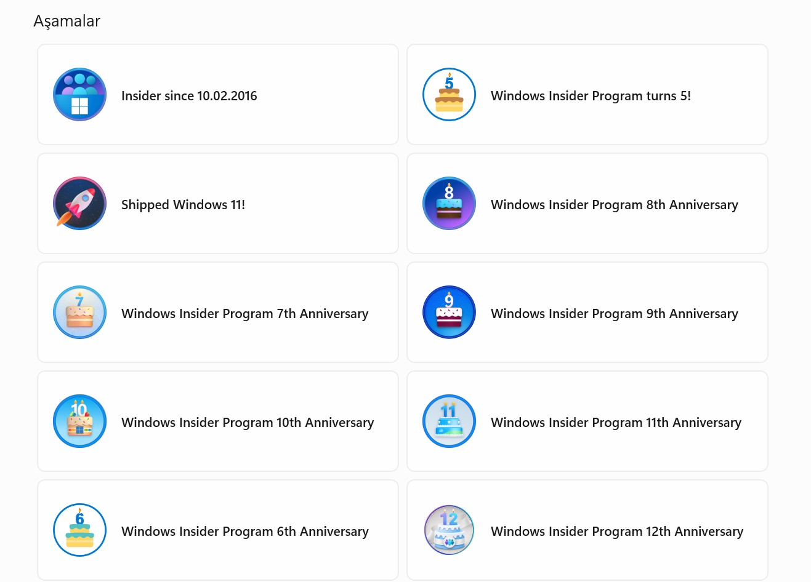

# Windows 11 26H1 ve Önceki Sürümler için .NET 3.5 ve Secure Boot Notları

Windows 11 26H1 ve önceki sürümlerde `.NET Framework 3.5` kurulum hataları, dil paketi yükleme problemi ve Windows UEFI CA 2023 medyasıyla Secure Boot durumunu belgeleyen çalışma alanı.

## Belgeler

- [.NET Framework 3.5: 26H1 kurulum ve dil paketi sorunu](docs/dotnet-35-windows-11-26h1.md)
- [Revizyon 2: Deneysel .NET MSI çıkarma akışı](docs/revision-2-dotnet35-experimental.md)
- [Secure Boot / Windows UEFI CA 2023](docs/secure-boot-windows-uefi-ca-2023.md)
- [Revizyon 3: PCA2023 ISO ve Secure Boot doğrulaması](docs/revision-3-secure-boot-2023.md)
- [Revizyon 5: ADK/WinPE ve 2023 imzalı ISO oluşturma](docs/revision-5-adk-winpe-secure-boot-2023.md)
- [Revizyon 6: Ventoy ve SecureBootRecovery.efi senaryosu](docs/revision-6-ventoy-securebootrecovery.md)
- [Revizyon 7: ISO'dan SecureBootRecovery.efi çıkarma ve Ventoy'a kopyalama](docs/revision-7-securebootrecovery-iso-ventoy.md)
- [Revizyon 8: Eski cihazlarda kurulum arayüzü ve USB portu seçimi](docs/revision-8-legacy-setup-usb-port-tips.md)

## Önemli

.NET MSI çıkarma/LaunchCondition değiştirme yöntemi Microsoft tarafından desteklenen kurulum yolu değildir. Secure Boot, UEFI DB ve firmware işlemleri önyükleme güvenini etkileyebilir; önce BitLocker kurtarma anahtarınızı yedekleyin ve OEM/Microsoft yönergelerini izleyin.

- [Windows ADK resmi indirme sayfası](https://learn.microsoft.com/en-us/windows-hardware/get-started/adk-install)
- [Windows PE resmi indirme sayfası](https://learn.microsoft.com/en-us/windows-hardware/manufacture/desktop/download-winpe--windows-pe)
- [Ventoy resmi indirme sayfası](https://www.ventoy.net/en/download.html)
- [Microsoft PCA2023 önyükleme medyası rehberi](https://support.microsoft.com/en-us/servicing/os/windows/2025/02/updating-windows-bootable-media-to-use-the-pca2023-signed-boot-manager)

---

## 🏆 Windows Insider Programı Kıdem ve Başarı Rozetleri (2016–2026)

Bu bölüm, **10 Şubat 2016** tarihinden bu yana kesintisiz sürdürülen Windows Insider erken önizleme (Canary / Dev / Beta) test geçmişini ve kazanılan resmi Microsoft başarı rozetlerini belgelemektedir.

### 1. Aşamalar ve Yıldönümü Rozetleri (`Milestones`)

| Rozet Adı | Durum | Teknik Anlamı ve Katkı Kapsamı |
| :--- | :---: | :--- |
| **Insider since 10.02.2016** | ✅ Aktif | Windows Insider Programı'na **10 Şubat 2016** tarihinde (Windows 10 *Redstone 1* geliştirme döneminde) katılımı belgeleyen başlangıç rozetidir. |
| **Shipped Windows 11!** | ✅ Aktif | Windows 11'in Ekim 2021'deki genel kullanıma çıkışından önceki erken önizleme yapılarını (`Build 21996 / 22000`) bizzat kurup test eden kurucu topluluğa verilen, sonradan kazanılması mümkün olmayan tek seferlik lansman rozetidir. |
| **Windows Insider Program turns 5!** | ✅ Aktif | Programın **5. kuruluş yıldönümünde** (2019) aktif olarak önizleme yapıları kuran ve test döngüsünde yer alan katılımcılara verilmiştir. |
| **Windows Insider Program 6th Anniversary** | ✅ Aktif | Programın **6. kuruluş yıldönümünde** (2020) aktif önizleme testi yapan kullanıcılara verilmiştir. |
| **Windows Insider Program 7th Anniversary** | ✅ Aktif | Programın **7. kuruluş yıldönümünde** (2021 — Windows 11 çekirdek geçiş dönemi) aktif kalan test uzmanlarına verilmiştir. |
| **Windows Insider Program 8th Anniversary** | ✅ Aktif | Programın **8. kuruluş yıldönümünde** (2022) önizleme kanallarında aktif test yapan kullanıcılara verilmiştir. |
| **Windows Insider Program 9th Anniversary** | ✅ Aktif | Programın **9. kuruluş yıldönümünde** (2023) önizleme yapıları kurmaya devam eden kıdemli kullanıcılara verilmiştir. |
| **Windows Insider Program 10th Anniversary** | ✅ Aktif | Programın **10. yıl dönümünde** (2024) on yıllık geliştirme ekosisteminde yer alan çekirdek test topluluğuna verilmiştir. |
| **Windows Insider Program 11th Anniversary** | ✅ Aktif | Programın **11. kuruluş yıldönümünde** (2025) aktif önizleme testi yapan en kıdemli Insider grubuna verilmiştir. |
| **Windows Insider Program 12th Anniversary** | 🔒 Kilitli | Henüz açılmamış olan 12. yıl dönümü rozetidir. |

### 2. Sınırlı Dağıtımlar (`Limited Flights` — Rütbe Rozetleri)

Microsoft'un yalnızca belirli sayıdaki Insider cihazına açtığı erken/deneysel yapıları (**Canary / Dev** kanalları) kurup test ettikçe kazanılan **2 ayrı seri (Mor Seri ve Yeşil Seri)** rütbelerinin tamamı eksiksiz olarak kazanılmıştır:

| Rütbe / Rozet Adı | Seri & Yıldız | Teknik Anlamı ve Seviye |
| :--- | :---: | :--- |
| **Flight Lieutenant** *(Uçuş Teğmeni)* | 🟣 Mor Seri (1 Yıldız) | Sınırlı dağıtımla yayınlanan erken önizleme yapılarını kurup test etmeye başlayan kullanıcılara verilen ilk rütbedir. |
| **Flight Captain** *(Uçuş Yüzbaşısı)* | 🟣 Mor Seri (2 Yıldız) | Erken dağıtım yapılarındaki yeni çekirdek özelliklerini ve kararlılık testlerini düzenli sürdüren ileri düzey test uzmanlarına verilir. |
| **Flight Major** *(Uçuş Binbaşısı)* | 🟣 Mor Seri (3 Yıldız) | Birinci sınırlı dağıtım döngüsünün **en üst rütbesidir**; en kısıtlı önizleme yapılarının tamamını kurup doğruladığınızı gösterir. |
| **Flight Lieutenant** *(Uçuş Teğmeni)* | 🟢 Yeşil Seri (1 Yıldız) | İkinci dönem sınırlı dağıtım (yeni nesil Windows 11 önizleme döngüsü) testlerine katılanlara verilen başlangıç rütbesidir. |
| **Flight Captain** *(Uçuş Yüzbaşısı)* | 🟢 Yeşil Seri (2 Yıldız) | İkinci dönem erken yapı testlerinde yüksek süreklilik gösteren uzmanlara verilen orta-ileri kademe rütbesidir. |
| **Flight Major** *(Uçuş Binbaşısı)* | 🟢 Yeşil Seri (3 Yıldız) | İkinci sınırlı dağıtım döngüsünün de **en üst rütbesidir**; güncel Canary / Dev yapılarının en erken sürümlerini sahada aktif olarak kurup doğruladığınızı kanıtlar. |
